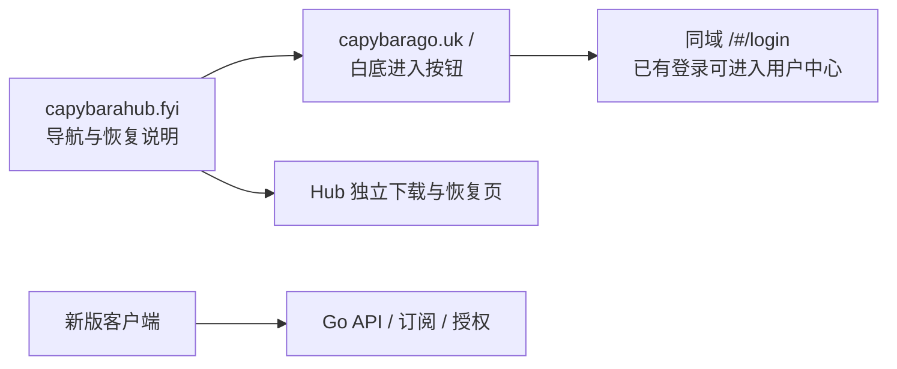

# Agent Note: Hub 导航与 Go 应用双域分工

Status: proposed

## Problem

用户指定 capybarahub.fyi 为导航域、capybarago.uk 为实际应用域，并提供[三毛导航](https://xn--ehqx35aimmzwv.com/)和[应用站](https://gw-2.smjc2.com/)作参考。随后明确本轮先完善方案和页面预览，并通过截图确认：点击导航入口后先出现白底、仅一个「点击进入官网」蓝色按钮的页面，再进入应用。不能将参考站已有登录会话下的 dashboard 误解为首次访问流程。

本次范围为独立静态交互预览与迁移设计；不修改生产域名、证书、网站模板、账号、客户端或更新索引。方案复用现有卡皮巴拉账号，不能照搬参考站“新老站账号不互通”的业务划分。

## Proposal

### 用户流程

| 域名或路径 | 职责 | 依赖与边界 |
| --- | --- | --- |
| capybarahub.fyi `/` | 收藏用导航：应用入口、客户端下载 | 纯静态；HTML 中直接包含可用链接；本地图片/样式；不登录、不加载 Go API、不自动跳走 |
| Hub 下载/说明页 | 完整安装包、签名、恢复说明，未来承接签名入口清单 | 要有独立存储和发布，不能只跳到 Go 下载页；本轮仅预览，没有安装包分发能力 |
| capybarago.uk `/` | 白底、一个「点击进入官网」按钮 | 轻量 HTML，无额外品牌块/倒计时/自动跳转；点击后才启动用户面板 |
| Go `/#/login` 等 | 登录、注册、用户中心、套餐和订单 | 复用现有 hash 面板及账号；已收藏深链接直接进入原路由，不重复过按钮页 |
| Go `/api/*`、订阅路径、`/desktop/login`、`/clients`、`/downloads/*`、支付回调 | 机器接口、授权及既有业务 | 完全绕过按钮页；保留方法、鉴权、响应类型和签名，不能全站加点击 Cookie 或 302 门禁 |
| taige.us / board.taige.us | 旧书签、原客户端、旧订阅及历史回调兼容 | 迁移期保留原服务与证书；不要求用户重注册，不将旧 API 直接 301 到新域 |
| node/edge.lumavia.fyi | 已有节点路径 | 本任务不迁移，不因网站域变更改用户节点身份或固定出口 |

Hub 视觉参考简单导航卡片，但只保留同一服务入口，不分裂新/老用户账号。按用户后续反馈，导航页删除账号说明、访问帮助卡片、帮助问答区与页脚；保留应用和下载入口，恢复说明的规划归属于独立下载/说明页。Go 的根页按用户截图只显示按钮，页面标题和键盘可访问性保留。按钮是展示选择，不是验证码、权限校验或防封措施；域名/SNI 阻断发生在页面之前，不能靠空白页或 `#` 路由消除。

预览中使用相对链接，双击 HTML 即可按 Hub → Go → 登录示意页体验；生产部署时分别放在上述域名。登录与下载按钮仅弹出明确的预览说明，不接受凭据、不发网络请求、不安装软件；预览与生产不会共用登录状态。

### 独立部署与稳定性边界

- Hub 必须是与 Xboard 应用不同的部署单元。导航 HTML、样式、图标和下载说明不从 Go 拉取，Go 停机时仍可阅读；导航不需要数据库，也不能通过同一故障跳板回源。
- Go 使用现有应用和同一权威数据源，API 尽量同源，减少跨域 Cookie/CORS 迁移。新域登录会话可能需要登录一次；不跨域复制 Cookie 或把令牌写入跳转参数。
- 这两个域名是“导航与应用隔离”，不是“两条应用备用入口”。Go 故障后 Hub 可以告知和分发修复，但仍需未来第二个独立服务域配合客户端选路，才能自动恢复 API。当前 DNS 查询显示两域都使用相同 Cloudflare NS，因此也不能称为 DNS/供应商独立容灾。
- Hub 作为第一条恢复分发路径，后续仍需独立的第二份签名分发。入口清单是客户端可验证的数据，不能依赖解析导航 HTML 获取可信 API；清单字段、验签、防回滚沿用[恢复提案](2026-11-02-client-entry-resilience.md)。
- 旧版客户端仍固定 taige.us；导航上线不等于旧版自动更新。恢复版须同时接入 Go/备用 API、独立更新索引和安装包来源，并保留应用 ID、凭据键和更新签名。
- 导航不伪造“在线”“极速”等状态，不把浏览器跨域 fetch 失败当作域名被墙。后续需要状态展示时，使用独立探针、观测时间和明确适用网络；本轮不启用监控。

### 后续实施顺序

1. 确定预览与分工：Hub 导航、Go 单按钮首屏、同账号登录；本轮交付到这里。
2. 准备 Hub 独立静态托管与 Go 原应用 HTTPS 入口，先固定地址验证证书、首页、公开 API 和实际网络路径，再配置 DNS；不同时迁移数据库或节点。
3. 只对 Go 根页启用轻量按钮展示；原 hash、邀请码、浏览器前进后退、桌面授权、API/订阅和支付回调分别回归。沿用 safe_mode 的受控主机校验，不能全局关闭来迁就新域。
4. 使用自有测试账号验证同账户权益、订单、订阅与固定出口，再安排应用主域、邮件/链接和支付配置切换；旧域兼容、回退保留。支付配置与真实回调需单独验收，不能从页面 200 推断。
5. 发布客户端恢复版与独立更新分发，完成四目标构建/签名/覆盖升级和国内无代理测试后分批迁移；通信通知另按用户授权执行。

## Existing decision audit

- [原官网首页](../../implemented/feature/2026-10-23-capybara-website-home.md)：部分重叠。未来仅 Go 根页增加按钮模式；原公开首页与 taige 兼容不在本轮修改，不改压缩 umi.js。本提案尚未替代现行实现。
- [客户端恢复规划](2026-11-02-client-entry-resilience.md)：部分重叠，本篇落实用户指定域名、网页旅程和部署分工；原提案继续管理客户端选路、缓存与更新信任。
- [客户端下载](../../implemented/feature/2026-10-23-capybara-client-downloads.md)：部分重叠，未来复用发布附件、索引和签名，但 Hub 必须独立持有完整包，不能只是换链接文字。
- [节点独立域名](../../implemented/architecture/2026-10-22-independent-node-domain.md)：职责边界保留，不迁移节点。
- [网站跳板](../../implemented/architecture/2026-10-22-website-flawless-relay.md)：是当前网络证据；本轮未改变现有橙云/跳板配置。已暂存与未暂存的香港入口及 Windows 兼容内容无关，不吸收。

## Alternatives considered

- **一个域名承担所有页面与接口**：维护最少、链接简单，但本次 taige 故障已证明控制和恢复通道会一起失联，采用导航/应用拆分。
- **Hub 自动跳转 Go**：少一次点击，但用户无法停留查看恢复说明，Go 失联时导航失去用途，因此保留可收藏的静态页。
- **Go 直接加载登录页**：步骤最少；用户截图明确要求单按钮首屏，因此根页增加一次点击，已有深链接和机器接口直接访问。
- **把按钮当全站门禁**：行为统一，但原生客户端、订阅和回调无法点击，会制造新故障；按钮只影响浏览器根页面展示。
- **照搬参考站的新老账号隔离**：适合完全独立业务，本项目只迁移入口，拆账号会损害客户体验，因此保持同一账号与权益。

## Acceptance criteria

当前预览：导航、Go 按钮、登录衔接、下载示意四页均可独立打开；Hub/Go 无 JS 仍可导航；导航页无账号说明、帮助区及页脚，下载入口为单列；登录输入只读，点击登录/下载仅显示预览说明；无第三方资源或实际凭据传输。桌面及 390/320 像素布局检查、链路点击、相对链接与脚本语法通过后交付。

未来生产：Go 停机时 Hub 及独立包仍可用；根页点击加载用户面板、登录深链接和历史回退不循环；新/旧域使用同一账号和权益；所有机器接口不返回按钮 HTML；桌面授权、更新签名、安装包完整下载与一次覆盖升级通过。DNS、页面部署、业务与客户端验收分别报告。

## Risks

两域仍可能共同受 DNS、CDN、账号或跨境网络故障影响；页面拆分不能承诺永久不被阻断。单按钮增加一步点击，不能扩展至所有应用深链接。Hub 若只引用 Go 的安装包仍不能独立救援；此能力尚未实施。跨域网页可能需要重新登录，保留账号并不意味着浏览器 Cookie 自动迁移。

## Preview evidence

预览源码位于 [docs/previews/capybara-entry](../../../../docs/previews/capybara-entry/README.md)，只作为设计产物。本轮未注册 Sites 托管项目、未绑定域名、未部署应用、未更改客户端版本；发布构建和生产结果不适用于当前预览。截图为本地验收产物，用户原截图中的浏览器账号和书签不进入仓库。
